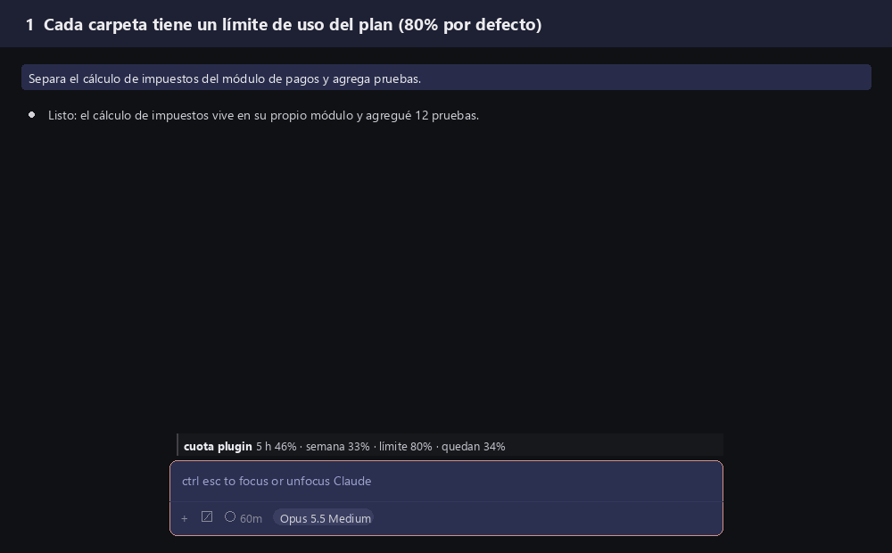

# Cuota: límite de uso por proyecto para Claude Code

[Read in English](README.md)

Tu plan de Claude tiene dos ventanas de uso, una de 5 horas y una semanal, y todo lo que haces las comparte: el trabajo de clientes, los proyectos personales, las pruebas. Una tarde intensa en un proyecto personal puede consumir la semana entera, y el trabajo que importa se detiene.

Para Claude Code en la **terminal** y en la **extensión de VS Code**.

**Cuota** pone un límite a cada carpeta, como el celular limita los datos por aplicación. Cada proyecto tiene un límite por defecto (80% de cada ventana). Diez puntos antes del límite, Claude empieza a cerrar lo que trae. En el límite, esa carpeta deja de aceptar mensajes nuevos, y lo que esté haciendo Claude se completa sin cortarse. Un comando sube el límite en las carpetas que lo necesitan.



## Instalación

En el prompt de una sesión de Claude Code en la terminal:

```
/plugin install cuota --marketplace chechesa-labs/claude-code-cuota
```

O desde una terminal del sistema:

```
claude plugin install cuota --marketplace chechesa-labs/claude-code-cuota
```

Responde `y` para agregar el marketplace y elige el alcance (el de usuario lo aplica a todos tus proyectos). Desde ahí, las sesiones nuevas lo cargan.

Requisitos: una versión reciente de Claude Code con soporte de mods (módulos de hooks de plugins), probado en la 2.1.310, y una suscripción Claude Pro o Max. Con una clave de API no hay ventanas de 5 horas ni semanales que leer, así que Cuota no tiene qué limitar.

## Compatibilidad

| Dónde | Estado |
| --- | --- |
| Extensión de Claude Code para VS Code | Probado en uso diario (2.1.310): línea de estado, comandos, aviso de cierre y freno |
| Claude Code en la terminal | Carga y responde `/cuota` (probado con `claude -p`); la línea de estado en sesión interactiva todavía no la hemos probado |

La extensión de VS Code usa la misma configuración de Claude Code que la terminal, así que con instalarlo una vez Cuota carga en las dos. En VS Code la línea de estado aparece sobre la caja de mensajes, precedida de `cuota plugin`.

## Qué ves

Una línea de estado bajo el prompt, que empieza con las cifras:

```
5 h 46% · semana 33% · límite 80% · quedan 34%
ve cerrando · 5 h 72% · semana 34% · límite 80% · quedan 8%
frenado · 5 h 80% · semana 34% · límite 80% · /cuota 90 para seguir
```

## Comandos

`/cuota` es para la ventana de 5 horas y `/cuotasemanal` para la semanal. Con Claude Code en inglés, el comando semanal es `/cuotaweek`. `/quota` también funciona, como alias de `/cuota`.

| Comando | Qué hace |
| --- | --- |
| `/cuota` | Muestra los límites de esta carpeta, el uso y cuándo se reinicia cada ventana |
| `/cuota 90` | Sube el límite de 5 h de esta carpeta a 90% (cualquier número del 1 al 100) |
| `/cuotasemanal 95` | Lo mismo con el límite semanal |
| `/cuota 100` | Deja esta carpeta sin límite de 5 h (también `/cuota libre`) |
| `/cuota default` | Regresa el límite de 5 h al de todas las carpetas |
| `/cuotasemanal default` | Regresa el límite semanal al de todas las carpetas |
| `/cuota 100 temporal` | Sin límite de 5 h hasta que se reinicie la ventana; después regresa solo |
| `/cuota lista` | Las carpetas con límite propio y su nombre corto |
| `/cuota 85 lora-baker nova` | Cambia varias carpetas por su nombre corto (padre/nombre si dos carpetas se llaman igual) |
| `/cuota default lora-baker nova` | Regresa varias carpetas al límite de 5 h de todas |
| `/cuota default sobre-80` | Solo las carpetas con límite de 5 h arriba de 80% |
| `/cuota default todas` | Todas las carpetas |
| `/cuota ayuda` | Todas las opciones |

Los comandos los responde el propio plugin: nunca llegan al modelo, no gastan tokens y siempre funcionan, aunque la carpeta esté frenada.

## Cómo decide

- **Una carpeta** es la raíz del repositorio git en el que estás; fuera de git, la carpeta de trabajo.
- **Ve cerrando:** a menos de 10 puntos de un límite, Cuota agrega una instrucción breve para Claude: terminar el paso en curso, dejar el estado escrito, no abrir nada nuevo y no lanzar agentes nuevos. Claude te sigue respondiendo como siempre.
- **Freno:** en el límite, los mensajes nuevos de esa carpeta esperan, con una nota de cómo subir el límite, y no se inician agentes nuevos. El turno en curso nunca se corta. Los mensajes que mandas mientras Claude trabaja sí pasan, para que puedas dar instrucciones de cierre.
- **Los agentes que ya están corriendo** reciben un mensaje para terminar su paso y entregar lo que tengan.
- **La lectura se comparte** entre sesiones: una sesión nueva arranca con la última lectura que vio cualquier sesión, hasta que esa ventana se reinicia.

## Configuración

Se ajusta al instalar, o después en `/config`:

| Opción | Por defecto | Qué significa |
| --- | --- | --- |
| Límite por defecto, ventana de 5 h | 80 | Porcentaje de la ventana de 5 h en el que se detienen las carpetas sin límite propio |
| Límite por defecto, ventana semanal | 80 | Lo mismo con la ventana semanal |
| La ventana de 5 h frena | sí | Apagado: la ventana de 5 h solo avisa |
| Margen del aviso "ve cerrando" | 10 | Puntos antes del límite en los que empieza el cierre |
| Idioma | auto | `auto` sigue el ajuste `language` de Claude Code (español o inglés); `es` o `en` lo fijan |
| Webhook | vacío | URL opcional que recibe un `POST` en JSON con cada lectura, cada freno y cada cambio de límite |

## Qué lee, qué envía y qué cambia

**Red.** Cuota hace un solo tipo de petición de red: un `POST` HTTP a la URL del webhook que configures. Sin webhook, que es lo predeterminado, no hace ninguna petición de red. No contacta ningún otro servidor, nunca descarga nada y nunca actúa sobre la respuesta del webhook. Apunta el webhook a una dirección `https` que controles.

**Qué recibe el webhook.** Un objeto JSON con: el evento (`medicion` para una lectura nueva, `estado` para un cambio de estado, `freno` cuando se detiene un mensaje o un agente, `politica` cuando cambia un límite), el id de la sesión, la carpeta de trabajo, la carpeta, la configuración (límites por defecto, margen de aviso y si la ventana de 5 h frena) y los límites propios de la carpeta, y la última lectura (porcentaje usado y hora de reinicio de cada ventana). Cada evento agrega su detalle: en `medicion`, las ventanas tal como las reportó Claude Code; en `estado`, el estado anterior y el nuevo; en `freno`, si se detuvo un mensaje o un agente; en `politica`, la ventana y su nuevo límite. Nunca incluye tus mensajes, la conversación, las respuestas de Claude, archivos ni código.

**Comandos y herramientas.** Cuota no ejecuta comandos, scripts ni herramientas. El único texto que envía dentro de Claude Code es un mensaje fijo de cierre a los agentes que ya estén corriendo cuando una carpeta llega a su límite ("esta carpeta llegó a su límite; termina el paso en que vas y entrega lo que tengas").

**Qué lee.** Los porcentajes de uso que Claude Code ya reporta para tu plan, el ajuste `language` de Claude Code y si las carpetas por encima de tu carpeta de trabajo contienen `.git`. Los límites y la última lectura se guardan en el almacenamiento propio del plugin, en tu equipo.

**Qué hace cada hook.**

| Hook | Qué hace |
| --- | --- |
| `session.start` | Registra los comandos, ubica la carpeta y toma la primera lectura |
| `session.measure` | Toma cada lectura nueva, actualiza la línea de estado y la envía al webhook si hay uno |
| `command.run` | Responde `/cuota`, `/cuotasemanal` y `/cuotaweek` |
| `prompt.compose` | Dentro del margen de aviso, agrega una sección a las instrucciones de Claude pidiéndole que vaya cerrando; no cambia nada más |
| `prompt.submit` | En el límite, detiene los mensajes nuevos de esa carpeta con una nota de cómo subir el límite; nunca cambia el texto de un mensaje, y los comandos, los mensajes enviados durante un turno y los avisos de tareas siempre pasan |
| `agent.spawn` | En el límite, no deja iniciar agentes nuevos en esa carpeta |

## Limitaciones conocidas

- Todavía no se ha verificado en una sesión real si el mensaje de cierre llega a un agente que ya está corriendo, ni si la instrucción de "ve cerrando" llega a los agentes además de a la conversación principal.
- Donde una organización administra Claude Code con configuración gestionada, la instrucción de "ve cerrando" solo corre si la organización incluye el plugin en esa configuración; la línea de estado, los comandos y el freno funcionan igual.
- Los límites trabajan sobre los porcentajes que Anthropic reporta para tu plan. El límite del 100% es de Anthropic y aplica a toda tu cuenta.

## Mantenimiento

Mantenido por Chechesa Labs. Lo usamos a diario en nuestro propio trabajo y en el de nuestros clientes. Los issues se atienden conforme el tiempo lo permite; instalación, configuración y soporte prioritario forman parte de nuestros servicios.

## Licencia

[MIT](LICENSE)

Cuota es un proyecto independiente de Chechesa Labs. No está afiliado, respaldado ni patrocinado por Anthropic. Claude y Claude Code son marcas de Anthropic.
