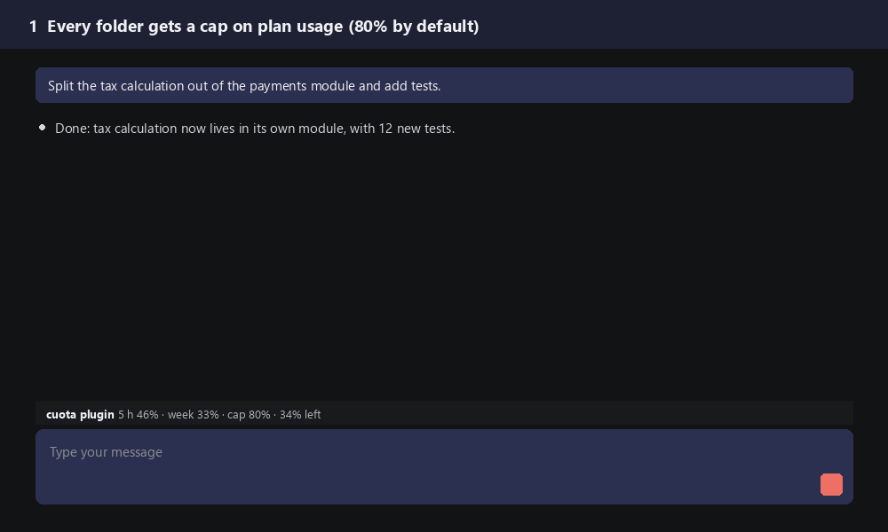

# Cuota: usage budget per project for Claude Code

[Leer en español](README.es.md)

Your Claude plan has two usage windows, a 5-hour one and a weekly one, and they are shared by everything you do: client work, side projects, experiments. One busy afternoon on a hobby project can use up the whole week, and the work that matters stops.

For Claude Code in the **terminal** and in the **VS Code extension**.

**Cuota** puts a cap on each folder, the way a phone caps data per app. Every project gets a default cap (80% of each window). Ten points before the cap, Claude gets a notice and keeps working as usual, leaving its progress ready to resume. At the cap, Claude pauses at a safe point, saves the progress and tells you how to go on; that folder stops taking new messages, and nothing is cut off halfway. One command raises the cap for the folders that need it.



## Install

At the prompt of a Claude Code terminal session:

```
/plugin install cuota --marketplace chechesa-labs/claude-code-cuota
```

Or from a shell:

```
claude plugin install cuota --marketplace chechesa-labs/claude-code-cuota
```

Answer `y` to add the marketplace, then choose the scope (user scope applies it to every project). New sessions load it from then on.

Requirements: a recent Claude Code with mod (plugin hooks module) support, tested on 2.1.310, and a Claude Pro or Max subscription. With an API key there are no 5-hour or weekly windows to read, so Cuota has nothing to cap.

## Compatibility

| Where | Status |
| --- | --- |
| Claude Code extension for VS Code | Tested in daily use (2.1.310 to 2.1.312): status line, commands, brake, and notice and pause in the middle of a task, background agents included |
| Claude Code in the terminal | Loads and answers `/cuota` (tested with `claude -p`); the interactive status line not yet tested by us |

The VS Code extension uses the same Claude Code settings as the terminal, so installing once makes Cuota load in both. In VS Code the status line shows above the message box, prefixed with `cuota plugin`.

## What you see

A status line under the prompt, starting with the figures:

```
5 h 46% · week 33% · cap 80% · 34% left
near the cap · 5 h 72% · week 34% · cap 80% · 8% left
braked · 5 h 80% · week 34% · cap 80% · /cuota 90 to go on
```

## Commands

`/cuota` is for the 5-hour window and `/cuotaweek` for the weekly one. With Claude Code set to Spanish, the weekly command is `/cuotasemanal`. `/quota` works too, as an alias of `/cuota`.

| Command | What it does |
| --- | --- |
| `/cuota` | Shows this folder's caps, usage and reset times |
| `/cuota 90` | Raises this folder's 5-hour cap to 90% (any number from 1 to 100) |
| `/cuotaweek 95` | Same for the weekly cap |
| `/cuota 100` | Removes this folder's 5-hour cap (also `/cuota free`) |
| `/cuota default` | Back to the default 5-hour cap |
| `/cuotaweek default` | Back to the default weekly cap |
| `/cuota 100-temp` | No 5-hour cap until the window resets; then it goes back by itself |
| `/cuota list` | Every folder with its own caps and its short name |
| `/cuota 85 lora-baker nova` | Changes several folders by short name (parent/name when two folders share a name) |
| `/cuota default lora-baker nova` | Sets several folders back to the default 5-hour cap |
| `/cuota default over-80` | Only the folders whose 5-hour cap is above 80% |
| `/cuota default all` | Every folder |
| `/cuota help` | All options |

Commands are answered by the plugin itself: they never reach the model, use no tokens, and always work, even when the folder is braked.

## How it decides

- **A folder** is the root of the git repository you are in; outside git, the working directory.
- **Wind down:** within 10 points of a cap, Cuota tells Claude, in the middle of a task if needed. The notice asks it not to cut the work short or summarize answers, only to keep its progress ready to resume. Claude still answers you as usual.
- **Pause:** at the cap, Claude finishes the current step, saves the progress where the project keeps it, and tells you your two options: go on now by raising the cap (using the reserve) or resume after the reset.
- **Brake:** at the cap, new messages in that folder are held with a note on how to raise the cap, and new agents are not started. The turn in progress is never cut off. Messages you send while Claude is working still get through, so you can give wrap-up instructions, and so does the progress agents hand back when they pause.
- **Running agents** get a message asking them to pause at a safe point and hand back their full progress, with what is left and how to resume.
- **Readings are shared** across sessions: a new session starts from the last reading any session saw, until that window resets.

## Settings

Set them when installing, or later in `/config`:

| Setting | Default | Meaning |
| --- | --- | --- |
| Default cap, 5-hour window | 80 | Percent of the 5-hour window where folders without their own cap stop |
| Default cap, weekly window | 80 | Same for the weekly window |
| The 5-hour window brakes | on | Off: the 5-hour window only warns |
| Wind-down margin | 10 | Points before the cap where the wind-down starts |
| Language | auto | `auto` follows Claude Code's `language` setting (Spanish or English); `es` or `en` pin it |
| Webhook | empty | Optional URL that receives a JSON `POST` on each reading, each brake and each change of cap |

## What it reads, sends and changes

**Network.** Cuota makes exactly one kind of network request: an HTTP `POST` to the webhook URL you set in its settings. With no webhook set, which is the default, it makes no network requests at all. It contacts no other host, never downloads anything and never acts on the webhook's response. Point the webhook at an `https` address you control.

**What the webhook receives.** A JSON object with: the event (`medicion` for a new reading, `estado` for a change of state, `freno` when a message or an agent is held, `politica` when a cap changes), the session id, the working directory, the folder, the settings (default caps, wind-down margin, whether the 5-hour window brakes) and the folder's own caps, and the latest reading (percent used and reset time of each window). Each event adds its own detail: for `medicion`, the windows as Claude Code reported them; for `estado`, the previous and the new state; for `freno`, whether a message or an agent was held; for `politica`, the window and its new cap. It never includes your messages, the conversation, Claude's answers, files or code.

**Commands and tools.** Cuota runs no commands, scripts or tools. The only things it writes inside Claude Code are short notices for Claude, which you do not see: one when the folder enters the wind-down margin or reaches its cap (with the window and the percentages), another when the notice no longer applies, and one fixed closing message to agents that are already running when the folder reaches its cap ("this folder reached its cap; pause at the next safe point and hand back your full progress"). Each notice is sent once per change of state.

**What it reads.** The usage percentages Claude Code already reports for your plan, Claude Code's `language` setting, and whether the folders above your working directory contain `.git`. Caps and the last reading are kept in the plugin's own store on your machine.

**What each hook does.**

| Hook | What it does |
| --- | --- |
| `session.start` | Registers the commands, finds the folder and takes the first reading |
| `session.measure` | Takes each new reading, updates the status line and sends it to the webhook if one is set |
| `command.run` | Answers `/cuota`, `/cuotasemanal` and `/cuotaweek` |
| `tool.call` | When the state changes, attaches the notice for Claude to the next tool result, so it reads it in the middle of a task; it changes neither the tool nor its result |
| `prompt.submit` | At the cap, holds new messages in that folder with a note on how to raise the cap. When the state changes, attaches the notice for Claude next to the message. It never changes the text of a message, and commands, messages sent during a turn and task notifications always go through |
| `session.compact` | After a compaction, sends the current notice again, in case the summary dropped it |
| `agent.spawn` | At the cap, refuses to start new agents in that folder |

## Known limits

- Caps work on the percentages Anthropic reports for your plan. The 100% limit itself is Anthropic's and applies to your whole account.

## Maintenance

Maintained by Chechesa Labs. We use it daily in our own work and in our clients' work. Issues are handled as time allows; installation, configuration and priority support are part of our services.

## License

[MIT](LICENSE)

Cuota is an independent project by Chechesa Labs. It is not affiliated with, endorsed by or sponsored by Anthropic. Claude and Claude Code are trademarks of Anthropic.
